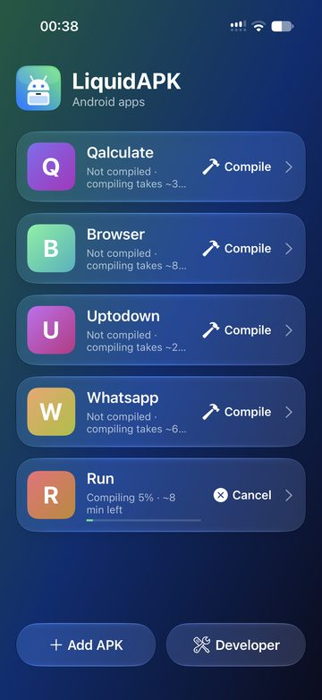
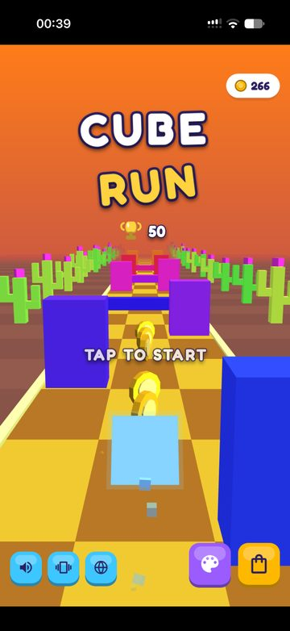
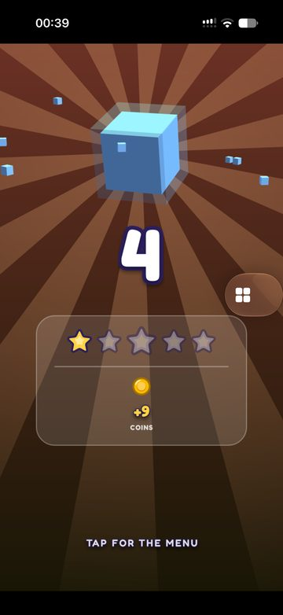
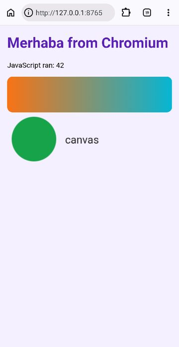
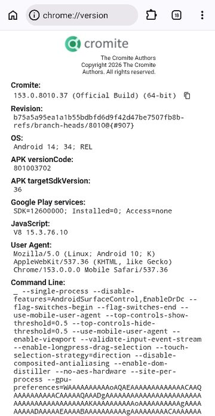
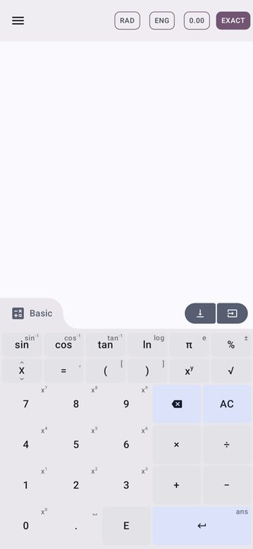

# Screenshots

## On an iPhone 16 Pro

The app's list (each APK compiled ahead of time in the background), and cube.run, a libGDX
game, drawn on the iPhone's GPU (OpenGL ES through ANGLE on Metal):

## From the host test

`build/iostest-gpu` runs the phone's code path with Mesa as the GPU (versions 0.73-0.74):
Cromite (Chromium 153) rendering a page with CSS, JavaScript and a canvas, its
chrome://version, Molly (Signal) and Qalculate!:

